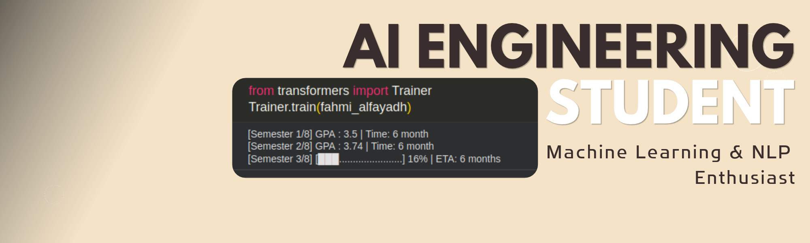

<h1 align="left">Little Things About Me</h1>

➡ Artificial Intelligence Engineering Student at Institut Teknologi Sepuluh Nopember (Indonesia)  
➡ Focused on building practical and intelligent systems  
➡ Currently focusing on Natural Language Processing and Retrieval-Augmented Generation  

🌍 **Personal Web:** [fahmialfayadh.site](https://fahmialfayadh.site)

---

### 🌐 Connect With Me

  
  
  
  

---

### 🧰 Tech Stack

  

| Domain | Focus |
|---|---|
| **Machine Learning** | Classical supervised & unsupervised learning, statistical & probabilistic modeling, ensembles & gradient boosting, tabular deep learning, anomaly detection, dimensionality reduction. Mainly **scikit-learn**, **XGBoost / LightGBM / CatBoost**, **PyTorch** |
| **Deep Learning & Computer Vision** | Convolutional neural networks (CNN) and Vision Transformers (ViT) for image understanding, built with **PyTorch** |
| **ML Engineering** | Feature engineering, AutoML, hyperparameter optimization, model interpretability, imbalanced learning. **Optuna**, **SHAP**, **AutoGluon** |
| **NLP & RAG** | Transformer models, embeddings, semantic search, retrieval pipelines. **Hugging Face**, **LangChain**, **Qdrant**, **FAISS** |
| **Data & Visualization** | Data processing, scientific computing, exploratory analysis. **Polars**, **Pandas**, **NumPy**, **SciPy**, **Plotly** |
| **Software & Systems** | Python backends with **Flask**, high-performance extensions with **Rust**, reproducible tooling with **uv** and **Jupyter** |
| **Security** | Applied cryptography and data security (symmetric ciphers) |

---

<table align="center">
  <tr>
    <td valign="top">
      
    </td>
    <td valign="top">
      
    </td>
  </tr>
</table>

